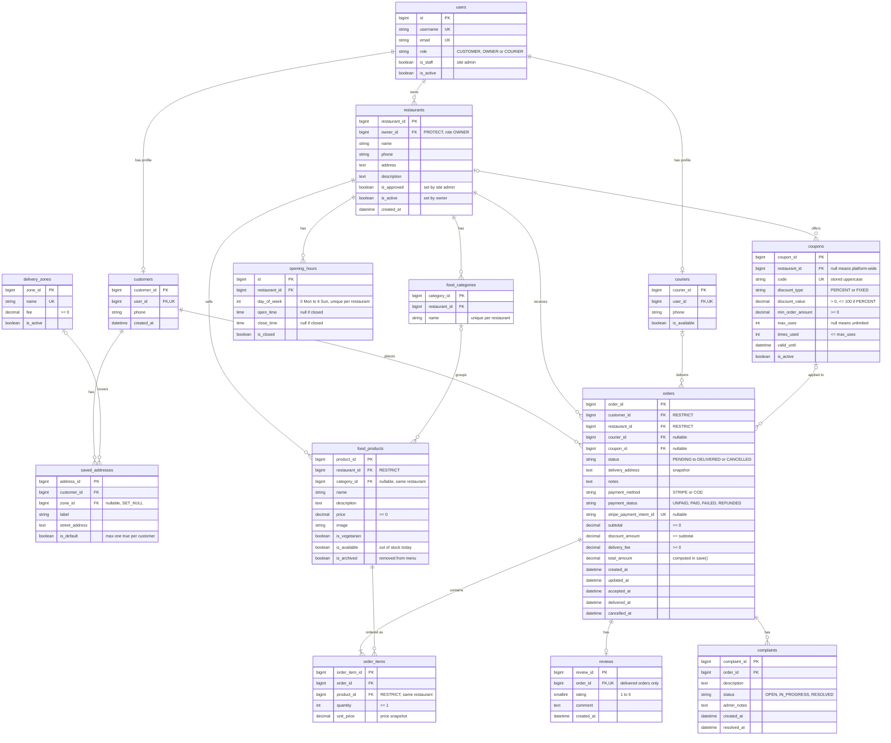
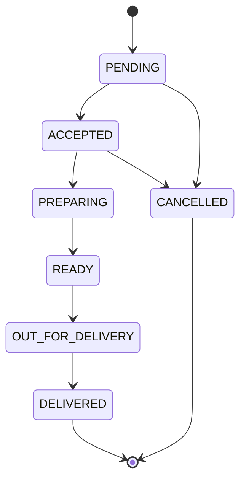

# Food Delivery – Database ER Diagram

Generated from the final `models.py` files (accounts, delivery, customer, restaurants, orders, dashboard).
GitHub renders this automatically; you can also paste the code block into https://mermaid.live.

## Order status flow

## App ownership

| App | Owner | Models |
|---|---|---|
| accounts | shared | User |
| customer | Person 1 | Customer, SavedAddress |
| restaurants | Person 2 | Restaurant, OpeningHour, FoodCategory, FoodProduct |
| orders | shared (Person 1 & 2) | Coupon, Order, OrderItem, Review |
| delivery | Person 3 | DeliveryZone, Courier |
| dashboard | Person 3 | Complaint |
